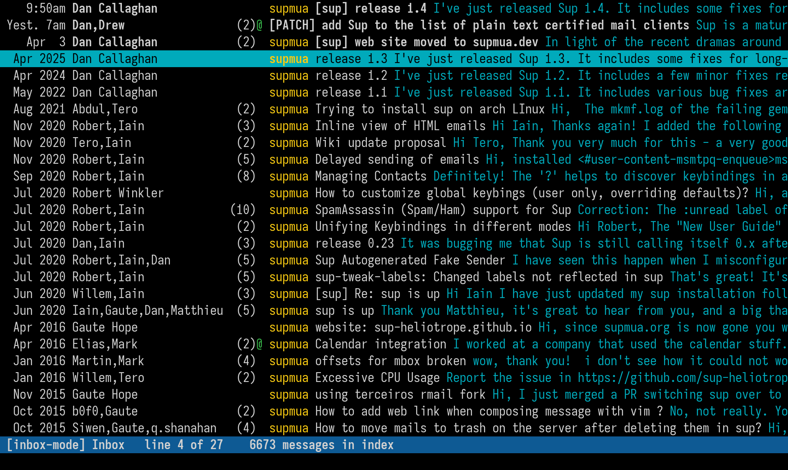
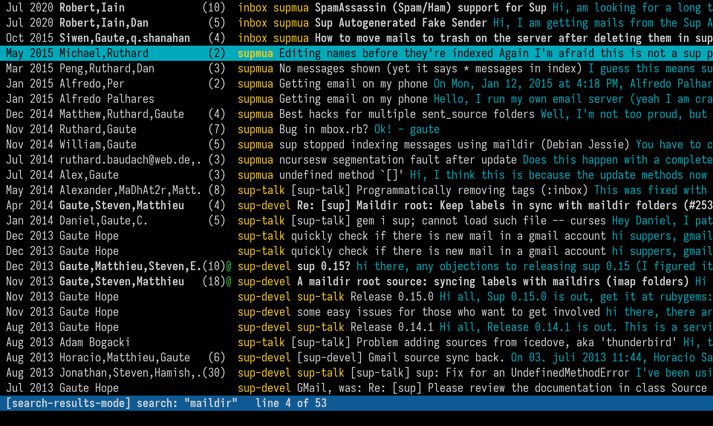
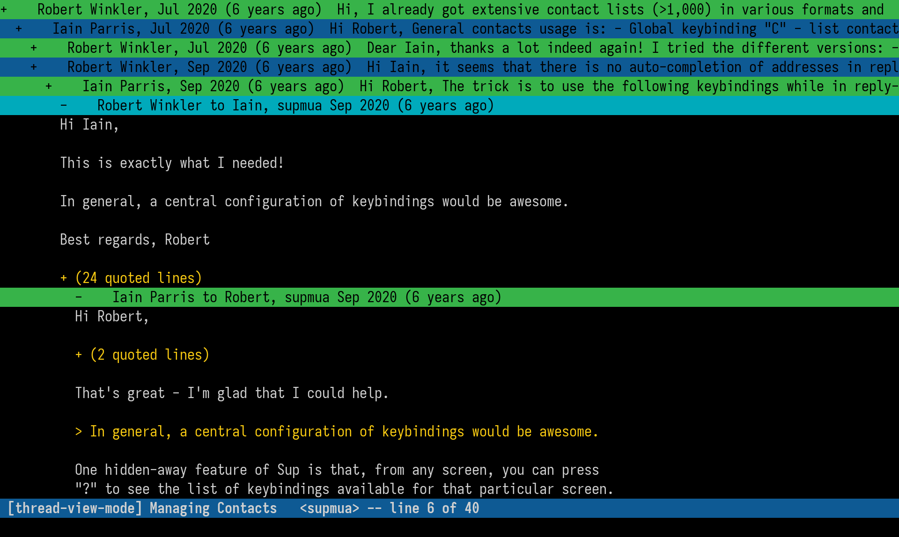
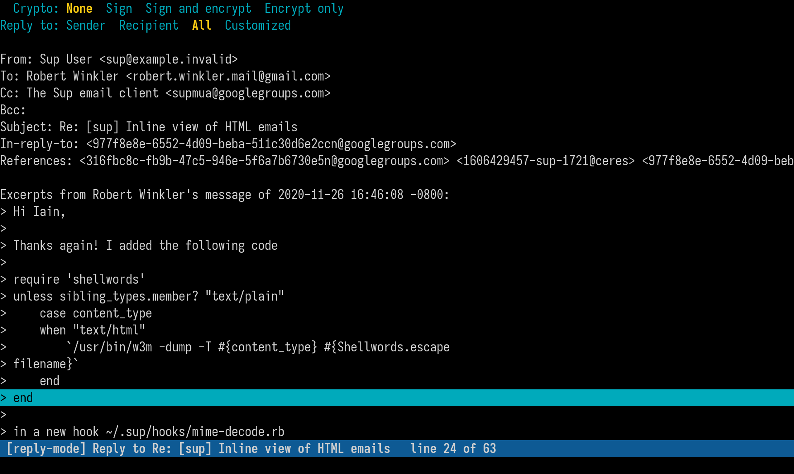
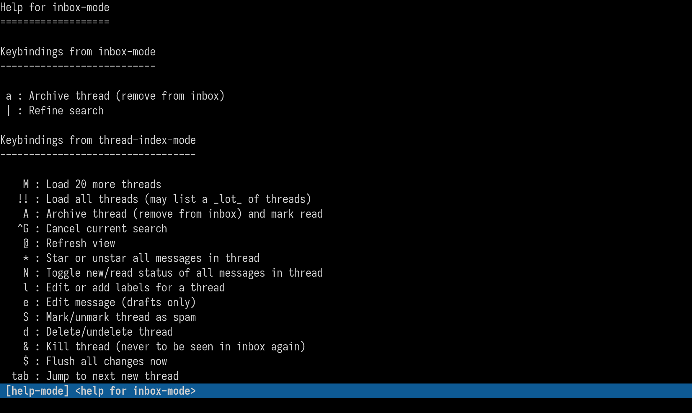
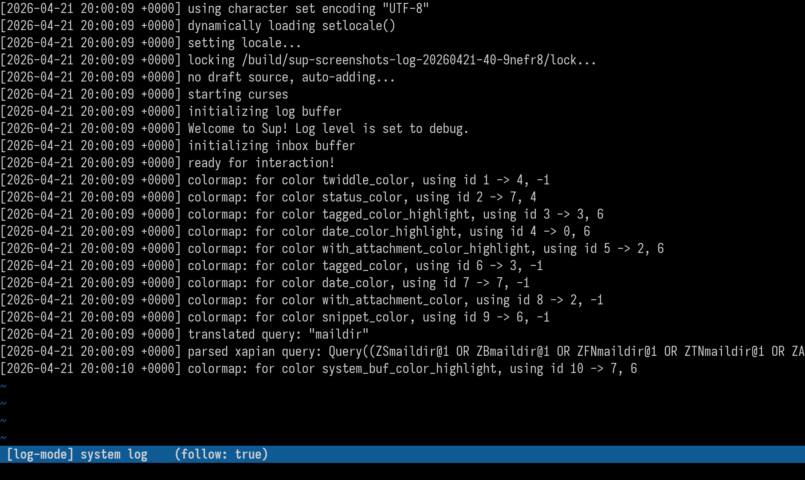
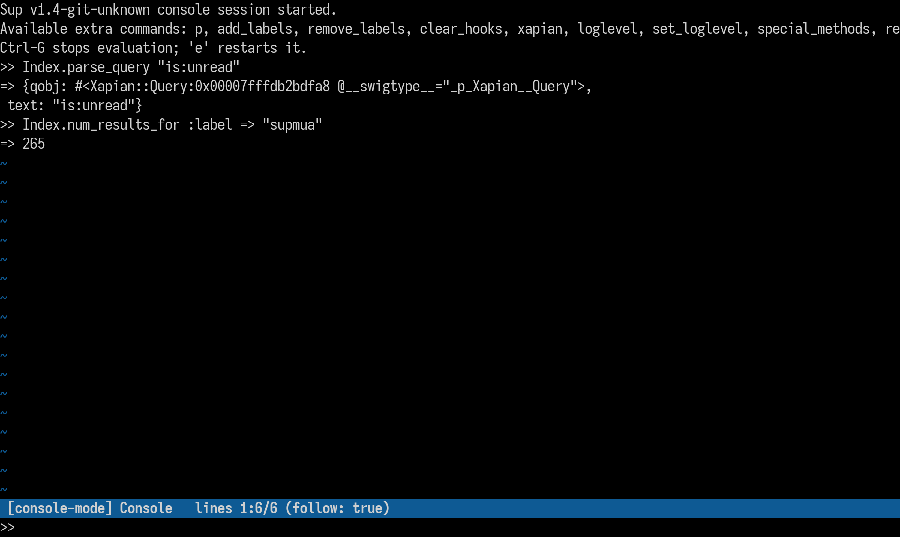

<figure>
  
  <figcaption>
    Sup starts in inbox-mode: a list of threads tagged <tt class="code">inbox</tt>.
  </figcaption>
</figure>
<figure>
  
  <figcaption>
    <a href="https://github.com/sup-heliotrope/sup/wiki/Searching-Your-Mail">Search your mail</a>
    and Sup displays a list of matching threads in search-results-mode.
  </figcaption>
</figure>
<figure>
  
  <figcaption>
    In thread-view-mode, read messages are collapsed to a single line by default.
  </figcaption>
</figure>
<figure>
  
  <figcaption>
    When replying to a message, reply-mode is pre-populated with quoted text.
    Press <tt class="code">Enter</tt> to edit the reply in your preferred editor.
  </figcaption>
</figure>
<figure>
  
  <figcaption>
    Press <tt class="code">?</tt> in any mode to see the key bindings for the current mode.
  </figcaption>
</figure>
<figure>
  
  <figcaption>
    The log-mode buffer shows Sup’s internal log messages for debugging purposes.
  </figcaption>
</figure>
<figure>
  
  <figcaption>
    Sup has a built-in interactive Ruby console.
    It can access Sup internal Ruby objects.
    You can use it for one-off scripting tasks or to debug your Ruby hook functions.
  </figcaption>
</figure>
